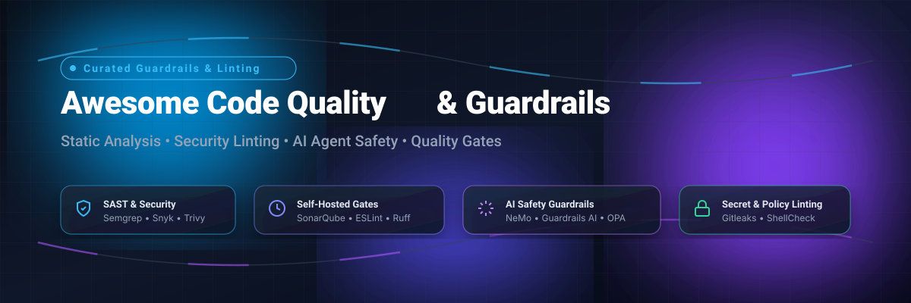

# Awesome Code Quality Guardrails & Safety Linting 🛡️✨

  

  
  
  
  
  
  
  

---

## 📖 Overview & SEO Insights

> **Curated directory of top-tier Static Application Security Testing (SAST), code quality guardrails, automated linters, secret scanners, and AI coding agent safety policies.**

In modern DevSecOps pipelines and AI-assisted software development, enforcing robust code standards and vulnerability guardrails is paramount. This repository tracks production-proven **SaaS platforms**, enterprise quality gates, and high-performance **open-source linting engines** designed to shift security left, detect technical debt early, and prevent regressions before code hits production.

---

## 📑 Table of Contents
- [📊 Sector Overview & Market Dynamics](#-sector-overview--market-dynamics)
- [🏢 SaaS & Enterprise Hosted Platforms](#-saas--enterprise-hosted-platforms)
- [💻 Top Open-Source GitHub Projects](#-top-open-source-github-projects)
  - [⚡ Linters, Formatters & SAST Analyzers](#-linters-formatters--sast-analyzers)
  - [🤖 AI Agent Safety & Policy Guardrails](#-ai-agent-safety--policy-guardrails)
- [🤝 How to Contribute](#-how-to-contribute)
- [💖 Support & Sponsorship](#-support--sponsorship)
- [📈 Star History](#-star-history)
- [⚖️ Disclaimer](#️-disclaimer)

---

## 📊 Sector Overview & Market Dynamics

The static code analysis and application security testing (AST) sector is estimated at approximately **$2.0 billion to $2.2 billion (2025/2026)** and projected to exceed **$4.2 billion by 2030** (expanding at ~17–18% CAGR), propelled by rapid enterprise DevSecOps adoption and the explosion of AI-generated code. The market is **moderately concentrated (semi-consolidated)** at the top—with leading enterprise platforms (Snyk, SonarSource, Veracode, Black Duck/Coverity, and Checkmarx) capturing over 50% of total revenue—while remaining competitive and fragmented across lower-tier specialized linters and developer-first startups.

---

## 🏢 SaaS & Enterprise Hosted Platforms

| Platform | Estimated Size (Valuation / Revenue) | Pricing (Starting Tier) | Free Tier / Free Trial Limits | Description |
| :--- | :--- | :--- | :--- | :--- |
| **[Snyk](https://snyk.io/)** 🛡️ | **~$7.4B–$8.5B Valuation** (~$326M ARR) | **Team plan:** $25/month per contributing developer | **Free plan forever:** 200 Open Source (SCA) tests/mo, 100 Code (SAST) tests/mo, 300 IaC tests/mo, 100 Container tests/mo | Developer-first security scanning across code, open source dependencies, containers, and IaC configs directly in CI/CD and IDEs. |
| **[SonarQube](https://www.sonarsource.com/)** 🔍 | **~$4.7B Valuation** (~$100M+ ARR) | **Team plan:** $34/month (up to 100,000 LOC) | **Free plan forever:** Up to 50,000 LOC for private projects; free without LOC limits for public open-source repos | The industry benchmark for code quality, security hot spots, and technical debt tracking across 30+ languages. |
| **[Veracode](https://www.veracode.com/)** 🏢 | **~$2.5B Valuation** (~$150M–$250M ARR) | **Standard annual contract:** ~$15,000/year base (starts ~$750–$1,000/contributor/yr) | **Free trial:** 14–30 day trial with full access to SAST, SCA, and pipeline flaw analysis; no permanent free plan | Enterprise AppSec platform providing comprehensive static analysis, dynamic testing, and software composition analysis with compliance reporting. |
| **[Coverity](https://www.synopsys.com/)** ⚙️ | **~$2.1B Valuation** (Black Duck carve-out, ~$100M+ ARR) | **Commercial license:** Starts at ~$720/year per user (custom enterprise contracts typically starting at $15k–$25k/yr) | **Free trial:** 14–30 day sales-provisioned evaluation trial (unlimited free analysis for qualifying open-source repos via Coverity Scan) | Deep enterprise static analysis and safety-critical defect detection for C, C++, Java, C#, and other core enterprise stacks. |
| **[Checkmarx](https://checkmarx.com/)** 🔒 | **~$1.15B Valuation** (~$200M+ ARR) | **Checkmarx One:** Starts at ~$30,000/year minimum platform commitment (~$1,000/developer/year for SAST) | **Free trial:** 14-day evaluation POC agreement upon sales approval (or 30-day trial for Developer Assist); no permanent free plan | Enterprise AST and ASPM suite covering static application security testing, API security, and supply chain risk management. |
| **[Code Climate](https://codeclimate.com/)** 📈 | **~$65M Raised** (~$10M–$15M ARR) | **Pro plan:** $20/contributor/month | **Free plan forever:** Unlimited analysis for public open-source repositories; 14-day free trial for private repos | Automated code review and maintainability analytics calculating test coverage, code smells, and churn metrics. |
| **[Codacy](https://www.codacy.com/)** 🎯 | **~$15M Raised** (~$15M–$18M ARR) | **Team plan:** $18/contributor/month (annual billing) or $21/month (monthly) | **Developer plan forever:** $0 (IDE-only offline scanning, unlimited auto-fix, SAST & secret linting); free cloud tier for OSS | Automated code review platform supporting 50+ linters and 12,000+ rules with security and code standard enforcement. |
| **[DeepSource](https://deepsource.com/)** ⚡ | **~$3M Raised** (Seed/YC, ~$2M–$5M ARR) | **Team plan:** $30/contributor/month (annual billing) | **Open Source plan forever:** $0 for public repos (unlimited members, 1,000 PR reviews/month); 14-day free trial on Team tier | Modern developer-focused static code analysis, auto-formatting, and vulnerability scanning with automated PR autofixing. |

---

## 💻 Top Open-Source GitHub Projects

Curated list of production-ready, open-source static analyzers, linters, and safety policy engines sorted by GitHub_Stars.

### ⚡ Linters, Formatters & SAST Analyzers

- **[Prettier](https://github.com/prettier/prettier)**  ✨  
  **An opinionated code formatter** supporting JavaScript, TypeScript, CSS, JSON, HTML, Markdown, and YAML. Enforces consistent style across teams without debates.

- **[Ruff](https://github.com/astral-sh/ruff)**  ⚡  
  **An extremely fast Python linter and code formatter**, written in Rust. Replaces Flake8, Black, isort, pydocstyle, and pyupgrade while executing 10–100x faster than traditional Python linters.

- **[ShellCheck](https://github.com/koalaman/shellcheck)**  🐚  
  **Gives warnings and suggestions for bash/sh shell scripts.** Finds syntax errors, parameter expansion quirks, and subtle shell scripting pitfalls before script deployment.

- **[Trivy](https://github.com/aquasecurity/trivy)**  🛡️  
  **Comprehensive and versatile security scanner.** Scans container images, file systems, Git repositories, virtual machine images, and Kubernetes configurations for known CVEs, misconfigurations, and sensitive secrets.

- **[Gitleaks](https://github.com/gitleaks/gitleaks)**  🔑  
  **SAST tool for detecting hardcoded secrets** like passwords, API keys, and tokens in git repos, commit histories, and CI pipelines with custom regex and entropy rules.

- **[ESLint](https://github.com/eslint/eslint)**  🔍  
  **The ubiquitous open-source JavaScript and TypeScript linter.** Fully pluggable architecture for checking code patterns, bug prevention, and style consistency.

- **[Biome](https://github.com/biomejs/biome)**  🚀  
  **One toolchain for your web project.** High-performance toolchain written in Rust that provides blazingly fast formatting and linting for JavaScript, TypeScript, JSX, and JSON.

- **[golangci-lint](https://github.com/golangci/golangci-lint)**  🐹  
  **Fast Go linters runner.** Manages and runs dozens of Go linters in parallel, caches analysis results, and integrates with all major IDEs and CI workflows.

- **[Semgrep](https://github.com/semgrep/semgrep)**  🎯  
  **Fast, lightweight static analysis for security and code quality.** Pattern-based scanning across 30+ programming languages with readable YAML rules matching syntax rather than regex.

- **[Facebook Infer](https://github.com/facebook/infer)**  🧠  
  **A static analyzer for Java, C, C++, and Objective-C.** Uses formal verification methods to detect null pointer exceptions, memory leaks, and concurrency race conditions.

- **[SonarQube Community Build](https://github.com/SonarSource/sonarqube)**  🏰  
  **Free, self-hosted static code analysis platform.** Analyzes 20+ programming languages for code smells, bugs, and security vulnerabilities with pull-request decoration and SARIF support.

---

### 🤖 AI Agent Safety & Policy Guardrails

- **[Open Policy Agent (OPA)](https://github.com/open-policy-agent/opa)**  📜  
  **Policy-based control for cloud-native environments.** CNCF graduated general-purpose policy engine that unifies policy enforcement across CI/CD guardrails, Kubernetes, and API gateways using Rego.

- **[Guardrails AI](https://github.com/guardrails-ai/guardrails)**  🚦  
  **Framework for adding guardrails to LLM applications.** Validates, structures, and enforces output guarantees (specifications, PII avoidance, anti-hallucination) on large language model responses.

- **[NeMo Guardrails](https://github.com/NVIDIA/NeMo-Guardrails)**  🛡️  
  **NVIDIA's open-source toolkit for building safe and trustworthy LLM conversational systems.** Enforces topical boundaries, prevents jailbreaks, and integrates validation checks into agent workflows.

- **[LLM Guard](https://github.com/protectai/llm-guard)**  🔒  
  **The security toolkit for LLM interactions.** Scans prompts and model outputs against prompt injection, malicious code generation, toxicity, and data leakage.

- **[KICS by Checkmarx](https://github.com/Checkmarx/kics)**  🏗️  
  **Keeping Infrastructure as Code Secure.** Open-source static analysis engine parsing Terraform, CloudFormation, Kubernetes manifests, Helm charts, and Dockerfiles for security misconfigurations.

---

## 🤝 How to Contribute

Contributions are warmly welcome! Help make this curated guide the most comprehensive resource for code quality and security guardrails:

1. **Fork the repository** 🍴
2. **Create a descriptive feature branch** (`git checkout -b feature/add-new-tool`)
3. **Add or refine tool details** in `README.md` (keep descriptions objective and verify URLs)
4. **Commit your modifications** (`git commit -m 'Add ToolX to static analysis section'`)
5. **Open a Pull Request** with a concise summary of the addition 🎉

---

## 💖 Support & Sponsorship

If you find this repository valuable for your engineering workflows, please consider supporting the project:

- ⭐ **Star this repository** to improve visibility for the developer community!
- 🍴 **Fork and share** with colleagues, DevOps leads, and security engineers.
- ☕ **Sponsor or buy a coffee**: Support ongoing curation and maintenance via the [GitHub Sponsor Dashboard](https://github.com/sponsors/ishandutta2007).

Thank you for helping keep the software ecosystem secure and resilient! 🙏

---

## 📈 Star History

---

## ⚖️ Disclaimer

- This is an independent, **community-curated directory** intended for informational and architectural guidance; inclusion does not constitute a commercial endorsement.
- Code quality, AST, and AI guardrails examine proprietary software artifacts and execution contexts; ensure least-privilege CI/CD scopes and examine vendor data governance agreements before integrating external services.
- Always cross-reference vendor pricing tiers and service limits before committing enterprise workloads.

---

  <b>Built for software engineers, security architects, and DevSecOps leaders worldwide. 🌐</b> 
  <i>Let's make software quality, code safety, and guardrail enforcement accessible, verifiable, and automated.</i>

